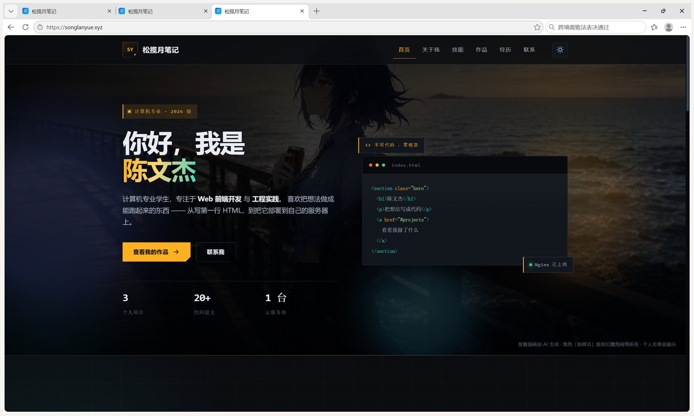
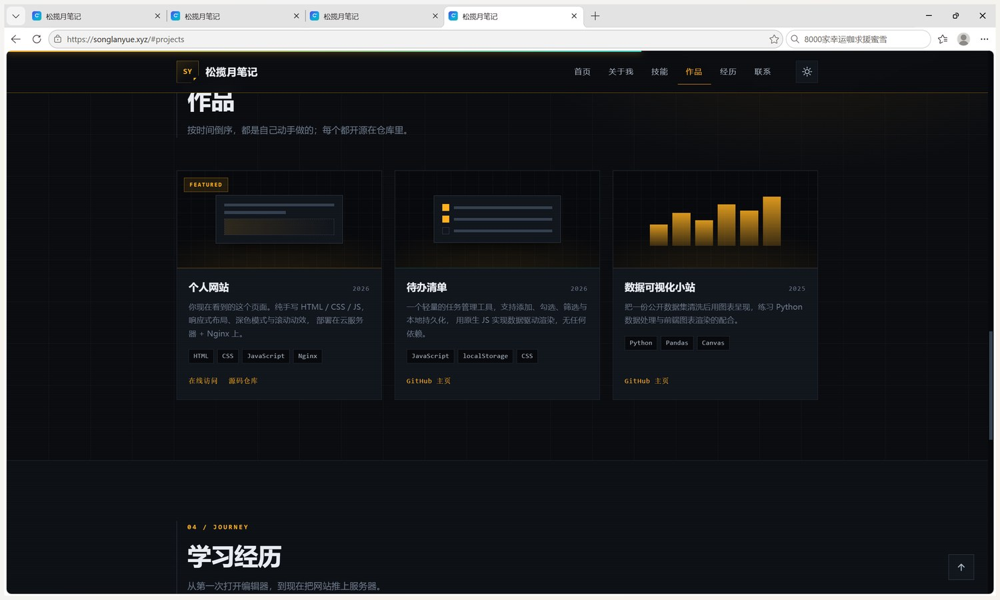
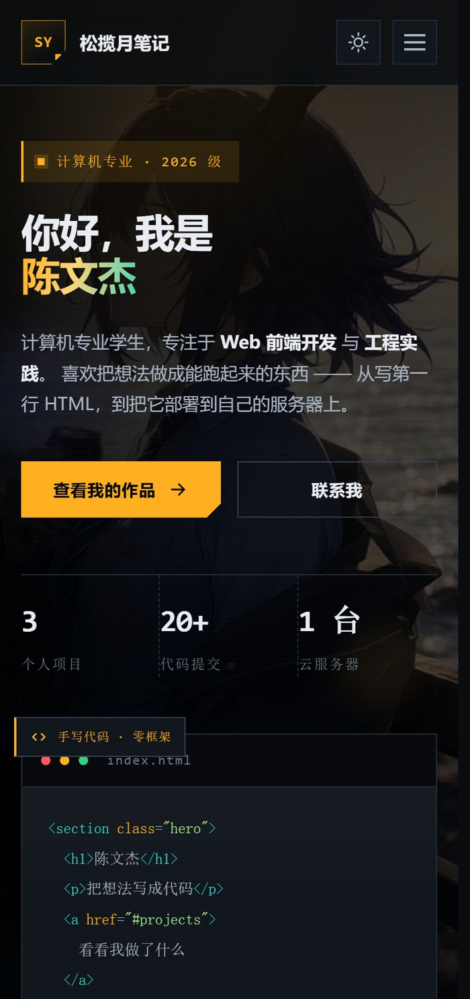
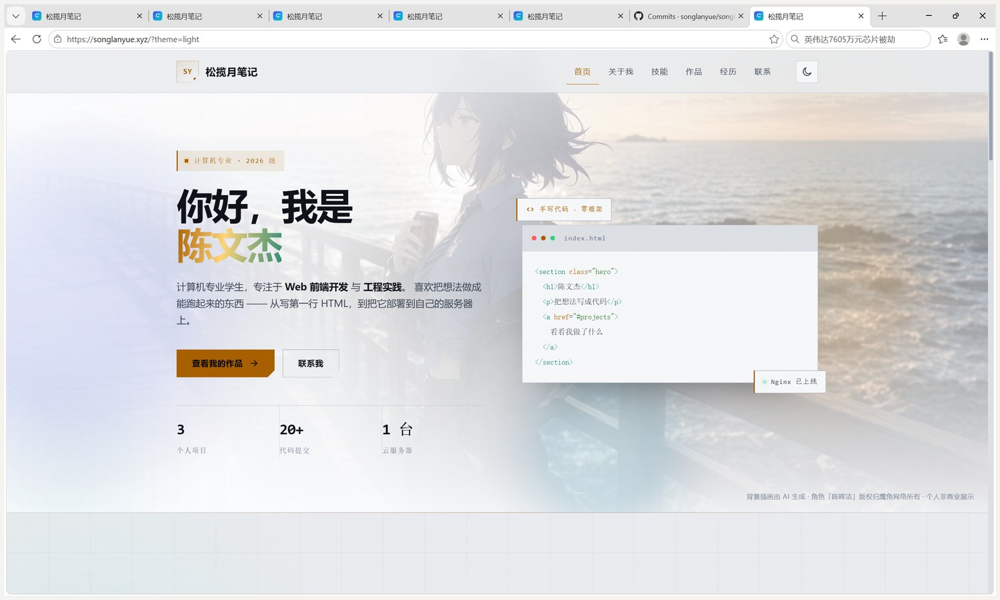
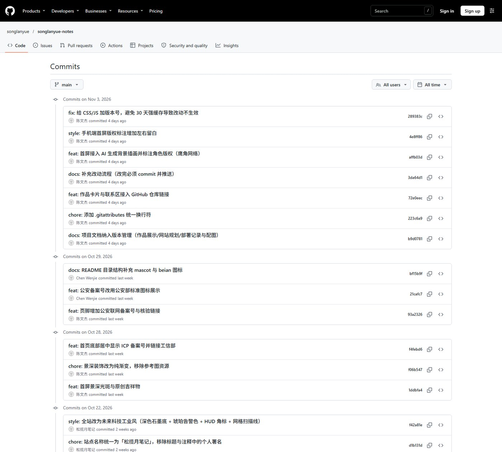

# 松揽月笔记 · 个人网站作品展示

学号：2026116040164　姓名：陈文杰

---

## 一、访问地址

**https://songlanyue.xyz**

- 服务器：阿里云 ECS，华中1（武汉-本地地域），Ubuntu 24.04 + Nginx 1.24
- 域名：`songlanyue.xyz`（阿里云注册，已实名）
- 已配置 HTTPS（Let's Encrypt 证书，自动续期），HTTP 自动 301 跳转到 HTTPS
- 直接使用 IP `http://8.148.29.209` 访问会被 Nginx 返回 444 断开，只允许域名访问

> 备注：域名已完成实名认证；ICP 备案已于 2026-10-27 通过审核，备案号 **蜀ICP备2026065247号**；公安联网备案已于 2026-10-29 通过，公安备案号 **川公网安备51142102511669号**。两条备案信息均已按要求展示在网站首页页脚底部居中位置，并分别链接至工信部与公安部的备案查询系统。

## 二、仓库地址

**https://github.com/songlanyue/songlanyue-notes**

仓库已设为 Public，根目录包含 `README.md`，累计提交 12 次。

代码结构：

```
songlanyue-notes/
├── index.html
├── css/style.css
├── js/main.js
├── assets/avatar.svg
├── assets/favicon.svg
├── robots.txt
├── sitemap.xml
└── README.md
```

## 三、效果截图

### 3.1 首页首屏



> 真实浏览器截图，地址栏完整露出 `https://songlanyue.xyz`；画面为深色工业风首屏、「你好，我是 陈文杰」主标题、代码卡片、数据条，以及右下角的插画版权标注。

### 3.2 作品板块



> 地址栏为 `https://songlanyue.xyz/#projects`，导航「作品」高亮；三张作品卡片含封面、简介、技术标签与「在线访问 / 源码仓库」链接。

### 3.3 移动端适配



> 390px 视口（2 倍像素密度）下的首屏与「关于我」，展示导航折叠成菜单按钮、按钮改为整行、数据条三列等响应式效果。

### 3.4 浅色主题



> 通过 `https://songlanyue.xyz/?theme=light` 进入浅色「技术图纸」主题（也可点右上角主题按钮切换）；首屏背景插画在浅色下自动降低对比度，保证深色文字可读。

## 四、Git 提交记录

### 4.1 提交历史截图



> 截图来源：公开仓库 <https://github.com/songlanyue/songlanyue-notes> 的 Commits 列表，按日期分组展示全部提交记录（共 24+ 次）。

### 4.2 提交记录摘要

| # | 提交信息 | 内容 |
| --- | --- | --- |
| 1 | chore: 初始化项目，添加 .gitignore | 建立仓库骨架 |
| 2 | feat: 完成首页结构，包含导航、首屏、关于我、技能、作品、经历、联系七个板块 | 页面主体 |
| 3 | style: 编写全站样式，含设计变量、深色模式与响应式布局 | 视觉体系 |
| 4 | feat: 增加主题切换、移动端菜单、滚动高亮与渐显动效 | 交互逻辑 |
| 5 | feat: 添加站点图标与头像插画素材 | 矢量素材 |
| 6 | docs: 补全 README，说明技术栈、目录结构、部署方式与常见问题 | 项目文档 |
| 7 | feat: 添加 robots.txt 与 sitemap.xml，便于搜索引擎收录 | SEO |
| 8 | chore: 移除页面中的学号与 AI 相关表述，邮箱改为站点域名 | 内容调整 |
| 9 | chore: 站点更名为「松揽月笔记」，同步标题、品牌与页脚 | 品牌 |
| 10 | chore: 站点名称统一为「松揽月笔记」，移除标题与注释中的个人署名 | 品牌 |
| 11 | style: 全站改为未来科技工业风（深色石墨底 + 琥珀告警色 + HUD 角标 + 网格扫描线） | 视觉改版 |
| 12 | feat: 首屏景深光斑与原创吉祥物 | 视觉装饰 |
| 13 | chore: 景深装饰改为纯渐变，移除参考图资源 | 规避版权风险 |
| 14 | feat: 首页底部居中显示 ICP 备案号并链接工信部 | 合规 |
| 15 | feat: 页脚增加公安联网备案号与核验链接 | 合规 |
| 16 | feat: 公安备案号改用公安部标准图标展示 | 合规 |
| 17 | docs: README 目录结构补充 mascot 与 beian 图标 | 文档 |
| 18 | docs: 项目文档纳入版本管理（作品展示/网站规划/部署记录与配图） | 文档归档 |
| 19 | chore: 添加 .gitattributes 统一换行符 | 工程规范 |
| 20 | feat: 作品卡片与联系区接入 GitHub 仓库链接 | 仓库互链 |
| 21 | docs: 补充改动流程（改完必须 commit 并推送） | 协作规范 |
| 22 | feat: 首屏接入 AI 生成背景插画并标注角色版权（鹰角网络） | 视觉升级 |
| 23 | style: 手机端首屏版权标注增加左右留白 | 移动端微调 |
| 24 | fix: 给 CSS/JS 加版本号，避免 30 天强缓存导致改动不生效 | 缓存策略修复 |
| 25 | style: 浅色主题首屏背景提高可见度 | 视觉微调 |

## 五、技术要点

| 项目 | 说明 |
| --- | --- |
| 前端 | 纯手写 HTML5 + CSS3 + 原生 JavaScript，零框架、零构建、零外部依赖 |
| 样式体系 | CSS 自定义属性统一管理色板，`color-mix` 做半透明层，`clip-path` 实现斜切角 |
| 交互 | `IntersectionObserver` 渐显、滚动进度条、导航高亮、移动端折叠菜单、主题切换（localStorage 持久化） |
| 适配 | 1440 / 1024 / 900 / 640 四档断点，移动端无横向溢出 |
| 服务端 | Nginx 静态托管，gzip 压缩，静态资源缓存 7 天，HTML 不缓存 |
| 安全 | 安全组仅开放 80/443，SSH 端口关闭，禁止 IP 直连，隐藏文件拒绝访问 |

## 六、图片素材与版权声明

首屏背景使用了一张 **AI 生成的插画**（海堤夕阳、紫发少女），画面角色为「陈晖洁」，版权归 **鹰角网络（Hypergryph）** 所有。
该图片仅用于本个人网站的非商业展示，**与鹰角网络官方无关**，本人不对其主张任何著作权。

网站上已在两处做了标注：

1. 首屏右下角：背景插画由 AI 生成 · 角色「陈晖洁」版权归鹰角网络所有 · 个人非商业展示
2. 页脚：本页背景插画（首屏海堤夕阳）由 AI 生成；画面角色「陈晖洁」的版权归鹰角网络（Hypergryph）所有。该图片仅用于本个人网站的非商业展示，与鹰角网络官方无关。

| 素材 | 来源 | 版权状态 |
| --- | --- | --- |
| ssets/hero-bg.webp | AI 生成（文生图） | 画面角色版权归鹰角网络，图片为非商业展示用途 |
| ssets/avatar.svg | 本人手写 SVG | 原创，可自由使用 |
| ssets/mascot.svg | 本人手写 SVG | 原创，可自由使用 |
| ssets/beian.png | 公安部备案图标 | 仅用于展示备案号 |
