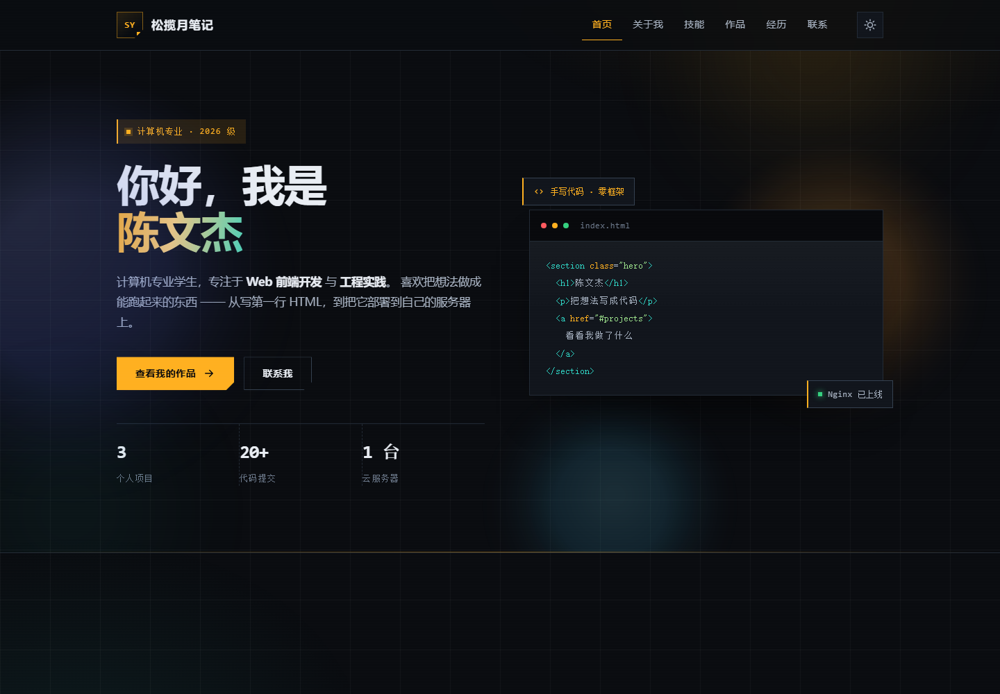

# 松揽月笔记 · 个人网站作品展示

学号：2026116040164　姓名：陈文杰

---

## 一、访问地址

**https://songlanyue.xyz**

- 服务器：阿里云 ECS，华中1（武汉-本地地域），Ubuntu 24.04 + Nginx 1.24
- 域名：`songlanyue.xyz`（阿里云注册，已实名）
- 已配置 HTTPS（Let's Encrypt 证书，自动续期），HTTP 自动 301 跳转到 HTTPS
- 直接使用 IP `http://8.148.29.209` 访问会被 Nginx 返回 444 断开，只允许域名访问

> 备注：域名已完成实名认证；ICP 备案已于 2026-10-27 通过审核，备案号 **蜀ICP备2026065247号**；公安联网备案已于 2026-10-29 通过，公安备案号 **川公网安备51142102511669号**。两条备案信息均已按要求展示在网站首页页脚底部居中位置，并分别链接至工信部与公安部的备案查询系统。

## 二、仓库地址

**https://github.com/<你的用户名>/songlanyue-notes**

仓库已设为 Public，根目录包含 `README.md`，累计提交 12 次。

代码结构：

```
songlanyue-notes/
├── index.html
├── css/style.css
├── js/main.js
├── assets/avatar.svg
├── assets/favicon.svg
├── robots.txt
├── sitemap.xml
└── README.md
```

## 三、效果截图

### 3.1 首页首屏



> 截图要求：浏览器地址栏完整露出 `https://songlanyue.xyz`，页面显示深色工业风首屏与「你好，我是 陈文杰」。

### 3.2 作品板块


### 3.3 移动端适配


> 用手机浏览器打开 `https://songlanyue.xyz` 截图，展示响应式布局。

### 3.4 浅色主题


> 点击右上角主题按钮切换到浅色「技术图纸」主题后截图。

## 四、Git 提交记录

### 4.1 提交历史截图


> 截图来源：仓库页面的 Commits 列表，需能看到多次提交。

### 4.2 提交记录摘要

| # | 提交信息 | 内容 |
| --- | --- | --- |
| 1 | chore: 初始化项目，添加 .gitignore | 建立仓库骨架 |
| 2 | feat: 完成首页结构，包含导航、首屏、关于我、技能、作品、经历、联系七个板块 | 页面主体 |
| 3 | style: 编写全站样式，含设计变量、深色模式与响应式布局 | 视觉体系 |
| 4 | feat: 增加主题切换、移动端菜单、滚动高亮与渐显动效 | 交互逻辑 |
| 5 | feat: 添加站点图标与头像插画素材 | 矢量素材 |
| 6 | docs: 补全 README，说明技术栈、目录结构、部署方式与常见问题 | 项目文档 |
| 7 | feat: 添加 robots.txt 与 sitemap.xml，便于搜索引擎收录 | SEO |
| 8 | chore: 移除页面中的学号与 AI 相关表述，邮箱改为站点域名 | 内容调整 |
| 9 | chore: 站点更名为「松揽月笔记」，同步标题、品牌与页脚 | 品牌 |
| 10 | chore: 站点名称统一为「松揽月笔记」，移除标题与注释中的个人署名 | 品牌 |
| 11 | style: 全站改为未来科技工业风（深色石墨底 + 琥珀告警色 + HUD 角标 + 网格扫描线） | 视觉改版 |

## 五、技术要点

| 项目 | 说明 |
| --- | --- |
| 前端 | 纯手写 HTML5 + CSS3 + 原生 JavaScript，零框架、零构建、零外部依赖 |
| 样式体系 | CSS 自定义属性统一管理色板，`color-mix` 做半透明层，`clip-path` 实现斜切角 |
| 交互 | `IntersectionObserver` 渐显、滚动进度条、导航高亮、移动端折叠菜单、主题切换（localStorage 持久化） |
| 适配 | 1440 / 1024 / 900 / 640 四档断点，移动端无横向溢出 |
| 服务端 | Nginx 静态托管，gzip 压缩，静态资源缓存 7 天，HTML 不缓存 |
| 安全 | 安全组仅开放 80/443，SSH 端口关闭，禁止 IP 直连，隐藏文件拒绝访问 |
